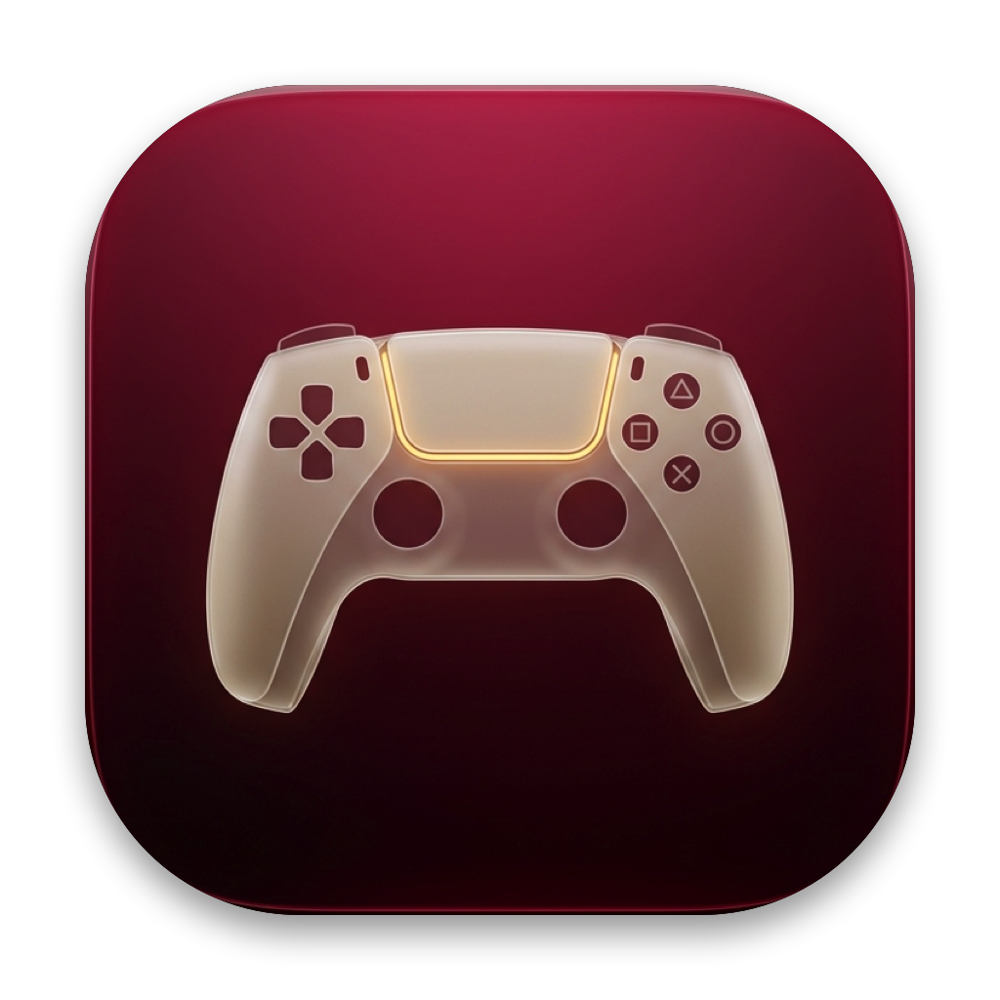

<p align="center">
  
</p>

<h1 align="center">
  Devotion — macOS Wireless DualSense Bridge & 120Hz FPS Booster<br/>
  <sub>《還願 Devotion》macOS 無線 PS5 DualSense 控制器轉接層 ＆ 120Hz 幀率加速補丁</sub>
</h1>

> 🤖 **AI-Generated Project Notice / AI 全自動生成專案聲明**
>
> - **English**: **100% of the code, reverse engineering, low-level IOKit/Mono/Objective-C runtime interposition architecture, FPS booster, app bundle, icon, and documentation in this repository were generated entirely by AI (Google DeepMind Antigravity). Human involvement was strictly limited to in-game playtesting (verified through a full end-to-end game completion).**
> - **繁體中文**：**本專案中 100% 的程式碼、底層 IOKit / Mono / Objective-C Runtime 動態攔截架構、幀率最佳化引擎、逆向分析、應用程式封裝、圖示與說明文件皆完全由 AI（Google DeepMind Antigravity）獨立撰寫生成；人類在開發過程中的參與僅限於實際進入遊戲進行遊玩測試（已完整通關全遊戲驗證）。**

---

## 📖 English Guide

### Overview
The macOS version of **Devotion** (*Red Candle Games*) officially supports only a **wired Sony DualShock 4 (PS4)** controller and was built with Unity 2020.2.1f1 + InControl (compiled prior to the release of the PlayStation 5 DualSense controller and Apple Silicon Retina MacBook Pros).

When playing on a modern Mac with a **Sony PlayStation 5 DualSense Wireless Controller** over Bluetooth:
1. **Unrecognized Controller**: Unity and InControl do not recognize `"DualSense Wireless Controller"` (`VID 0x054C`, `PID 0x0CE6`), falling back to an unmapped generic profile where only the Left Stick functions and all buttons, triggers, and the Right Stick are unresponsive.
2. **Encapsulated Bluetooth HID Reports**: On macOS Bluetooth, DualSense encapsulates its full 78-byte Report `0x31` payload (buttons, D-Pad hat switch, right stick, triggers, and hardware sequence counter) inside a 77-byte vendor-defined HID element (`UsagePage 0xFF00`, `Usage 0x3B`), causing standard `IOHIDDeviceGetValue` / `IOHIDValueGetIntegerValue` queries on individual button and axis elements to return `0`.
3. **Retina Resolution GPU Bottleneck & VSync Stutter**: On Apple Silicon Retina displays (e.g., `3024×1964` or `3456×2234` = ~6–7.7 million pixels), Unity renders deferred lighting, volumetric fog, SSAO, and shadows at full native Retina pixel density while double-buffered VSync drops any frame that misses the 16.6ms window down to 30 FPS.

This project provides a standalone macOS launcher app (**`Devotion (DualSense).app`**) powered by a **zero-modification, non-invasive dynamic library shim** (`libds4_shim.dylib`) injected via `DYLD_INSERT_LIBRARIES`. **No files inside `/Applications/Devotion.app` are modified.**

---

### 🚀 Installation & How to Play (Recommended: App Bundle)

1. **Install the Base Game**:
   Ensure *Devotion* is installed at `/Applications/Devotion.app`.
2. **Download the Release App**:
   Go to the [**Releases**](https://github.com/passs0/devotion-dualsense/releases) page and download **`Devotion-DualSense-v1.1.0-macOS.zip`**.
3. **Move to Applications**:
   Unzip the archive and drag **`Devotion (DualSense).app`** into your **`/Applications`** folder.
4. **First-Launch Gatekeeper Clearance (macOS)**:
   Because the app is ad-hoc signed without a paid Apple Developer ID certificate, run the following command once in Terminal (or right-click -> **Open**) to clear the macOS download quarantine attribute:
   ```bash
   xattr -cr "/Applications/Devotion (DualSense).app"
   ```
5. **Connect & Play**:
   - Pair and wake up your **PS5 DualSense Wireless Controller** via Bluetooth in macOS System Settings.
   - Launch **`Devotion (DualSense)`** directly from **Applications**, **Launchpad**, **Spotlight**, or your **Dock**!

---

### ⚡ Built-in 120Hz FPS Booster & Retina Optimizer (New in v1.1.0)
- **Smart Retina Resolution Scaling**: Automatically intercepts `UnityEngine.Screen::SetResolution` and scales excessive Retina framebuffer resolutions (such as `3024×1964` or `3456×2234`) down to **`1920` wide at your exact native aspect ratio** (e.g., `1920×1248` on 14"/16" MacBook Pro), reducing GPU pixel-shading load by **~60% (2×–2.5× higher FPS)** while preserving crisp 1080p+/1200p visual quality.
- **120Hz ProMotion Unlock & VSync Stutter Removal**: Intercepts `UnityEngine.Application::set_targetFrameRate` and `UnityEngine.QualitySettings::set_vSyncCount`, disabling double-buffered VSync drops (`vSyncCount = 0`) and unlocking the frame rate target to **120 FPS**.
- **Optional Environment Overrides**:
  - `DS4_TARGET_FPS`: Override target frame rate (default: `120`).
  - `DS4_MAX_WIDTH`: Override maximum internal render width (default: `1920`; set to `0` for native unscaled Retina).

---

### 🛠️ Alternative: Build from Source or Launch via CLI
If you prefer to build the universal (`x86_64` + `arm64`) binary and `.app` bundle from source:
```bash
git clone https://github.com/passs0/devotion-dualsense.git
cd devotion-dualsense

# Build libds4_shim.dylib and "Devotion (DualSense).app"
make

# Copy "Devotion (DualSense).app" directly into /Applications
make install
```
You can also launch the game directly from the terminal using the included script:
```bash
./launch_devotion.command
```

---

### 🎮 Controller Mapping
| DualSense Control | In-Game Function (DualShock 4 Equivalent) |
| :--- | :--- |
| **Left Stick** | Move / Menu Navigation |
| **Right Stick** | Camera Look / Rotate Object (Zero-latency coalesced) |
| **Cross (✕)** | Confirm / Interact / Inspect |
| **Circle (◯)** | Cancel / Back / Put Away |
| **Square (□)** | Action / Use Held Item |
| **Triangle (△)** | Open Inventory / Notes |
| **D-Pad (Up / Down / Left / Right)** | Menu & Item Selection |
| **L1 / R1 / L2 / R2** | Bumpers & Triggers (Gaze / Focus) |
| **Options** | Pause Menu |

---

### ⚙️ Technical Architecture
- **IOKit Hardware Spoofing (`IOHIDDeviceGetProperty`)**: Spoofs the Bluetooth DualSense (`0x054C:0x0CE6`) as a wired USB Sony DualShock 4 controller (`VID 0x054C`, `PID 0x05C4`, Transport `"USB"`, Product `"Wireless Controller"`, Manufacturer `"Sony Interactive Entertainment"`).
- **Objective-C Runtime Swizzling (`GameController.framework`)**: Swizzles `GCController` `vendorName` and `productCategory` so macOS GameController reports `"Sony Interactive Entertainment Wireless Controller"`.
- **500Hz Bluetooth Report `0x31` (`0xFF00:0x3B`) Parser & Coalesced Queue Engine**:
  - Parses the 77-byte vendor HID report in real time and deduplicates packets via the DualSense 32-bit monotonic hardware packet counter.
  - Interposes `IOHIDDeviceGetValue`, `IOHIDValueGetIntegerValue`, and `IOHIDQueueCopyNextValueWithTimeout`.
  - Uses coalesced atomic dirty flags for all 6 analog axes (`LX`, `LY`, `RX`, `RY`, `L2`, `R2`) and drains pending raw queue events on every poll so the Right Stick camera control operates with **zero FIFO queue backlog and zero latency**.
- **Mono Internal Call Hooks (`UnityEngine.Input`, `Application`, `QualitySettings`, `Screen`)**: Hooks Unity's internal calls via `dlsym("mono_add_internal_call")` with zero-allocation in-place UTF-16 string reading for complete compatibility across Main Menu UI, in-game controls, and rendering performance.

---

## 📖 繁體中文指南 (Traditional Chinese)

### 專案簡介
赤燭遊戲（Red Candle Games）出品的《**還願 Devotion**》macOS 版本原生僅支援**有線連接的 PS4 DualShock 4 控制器**（基於 Unity 2020.2.1f1 與舊版 InControl 輸入系統，於 PS5 DualSense 與 Apple Silicon Retina Mac 問世前編譯）。

當玩家在現代 macOS 上透過藍牙連接 **PS5 DualSense 無線控制器**時，會遇到三大問題：
1. **無法識別控制器**：遊戲與 InControl 無法識別 `"DualSense Wireless Controller"`（`VID 0x054C`、`PID 0x0CE6`），導致退回無設定檔的預設模式，除了左類比搖桿外，所有按鍵、板機與右類比搖桿皆無法運作。
2. **藍牙封包封裝結構差異**：在 macOS 藍牙模式下，DualSense 會將完整的 78-byte `0x31` 藍牙輸入封包（包含所有按鍵、十字鍵、右搖桿、L2/R2 板機與硬體序號）封裝於 77-byte 的廠商自訂 HID 元件（`UsagePage 0xFF00`、`Usage 0x3B`）中，導致標準 IOKit `IOHIDDeviceGetValue` 與 `IOHIDValueGetIntegerValue` 讀取各按鍵與軸向時永遠回傳 `0`。
3. **Retina 高解析度渲染瓶頸與 VSync 掉幀**：在 MacBook Pro 的 Retina 螢幕（如 `3024×1964` 或 `3456×2234`，高達 600～770 萬像素）下，Unity 預設以原生超高像素密度運算延遲光照、體積霧與陰影，且雙緩衝 VSync 只要超過 16.6ms 就會直接將幀率砍半至 30 FPS。

本專案提供獨立封裝的 macOS 啟動器應用程式（**`Devotion (DualSense).app`**），內建 `libds4_shim.dylib` 動態轉接與幀率加速層，在記憶體中即時完成 DualSense 藍牙封包解碼、DualShock 4 硬體偽裝與 120Hz 效能最佳化，**完全不需要修改 `/Applications/Devotion.app` 內的任何遊戲檔案**（已實機完整通關全遊戲驗證）。

---

### 🚀 安裝與遊玩步驟（推薦：使用 `.app` 應用程式）

1. **確認主程式位置**：
   請先確認《還願》主程式已安裝於 `/Applications/Devotion.app`。
2. **下載 Release 應用程式**：
   前往本專案的 [**Releases**](https://github.com/passs0/devotion-dualsense/releases) 頁面，下載 **`Devotion-DualSense-v1.1.0-macOS.zip`**。
3. **移至「應用程式」資料夾**：
   解壓縮後，將 **`Devotion (DualSense).app`** 拖曳至您的 **`/Applications`（應用程式）** 資料夾中。
4. **首次執行解除 macOS 隔離屬性**：
   由於此應用程式使用本地端 Ad-hoc 簽章，首次開啟前請於「終端機（Terminal）」執行以下指令以移除下載隔離標籤：
   ```bash
   xattr -cr "/Applications/Devotion (DualSense).app"
   ```
5. **連接手把並開始遊戲**：
   - 透過 macOS 藍牙配對並喚醒您的 **PS5 DualSense 無線控制器**。
   - 直接從 **「應用程式 (Applications)」**、**Launchpad**、**Spotlight** 或 **Dock** 點擊開啟 **`Devotion (DualSense)`** 即可使用無線 DualSense 高幀率流暢遊玩！

---

### ⚡ 內建 120Hz 幀率加速與 Retina 智慧縮放引擎 (v1.1.0 新增)
- **Retina 智慧解析度最佳化**：自動攔截 `UnityEngine.Screen::SetResolution`，將過高的 Retina 原始渲染解析度（如 `3024×1964`）等比例最佳化為 **`1920` 寬度並完美保留原生螢幕長寬比**（例如 14"/16" MacBook Pro 自動設為 `1920×1248`），減少約 **60% 的 GPU 像素著色負擔（幀率提升 2～2.5 倍）**，同時維持細膩銳利的畫面表現。
- **120Hz ProMotion 幀率解鎖與移除 VSync 卡頓**：自動攔截 `Application::set_targetFrameRate` 與 `QualitySettings::set_vSyncCount`，關閉會導致掉至 30 FPS 的雙緩衝垂直同步（`vSyncCount = 0`），並將目標幀率解鎖至 **120 FPS**。
- **零記憶體配置輸入熱路徑**：移除每幀約 40 次的 Mono UTF-8 動態記憶體配置，改為堆疊內直接讀取 UTF-16 字串。

---

### 🛠️ 進階選項：從原始碼編譯或使用終端機腳本啟動
若您希望自行從原始碼編譯通用架構（`x86_64` + `arm64`）動態庫與 `.app` 應用程式：
```bash
git clone https://github.com/passs0/devotion-dualsense.git
cd devotion-dualsense

# 編譯 libds4_shim.dylib 與 "Devotion (DualSense).app"
make

# 將 "Devotion (DualSense).app" 安裝至 /Applications
make install
```
亦可在終端機直接透過啟動腳本執行：
```bash
./launch_devotion.command
```
